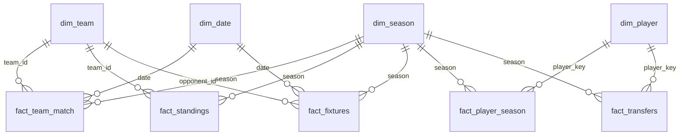

# ⚪🔵 Brighton & Hove Albion — Dashboard de Desempenho

Pipeline de dados em Python que coleta, trata e modela dados do Brighton na Premier League
a partir de fontes abertas e de uso permitido, alimentando um dashboard em Power BI com
6 páginas: visão geral, tabela da liga, momento da temporada, jogadores, transferências e
histórico.

> Temporada em destaque: **2026/27**, com comparação às quatro temporadas anteriores.
> Projeto pessoal de portfólio, sem fins comerciais e sem afiliação com o clube ou a Premier League.

| Visão Geral | Tabela da Liga | Momento da Temporada |
|---|---|---|
|  |  |  |
| **Jogadores** | **Transferências** | **Histórico** |
|  |  |  |

---


## Fontes e licenças

Antes de escrever qualquer scraper, verifiquei o `robots.txt` e os termos de uso de cada fonte.
Três fontes populares em projetos de futebol foram **descartadas**:

| Fonte descartada | Motivo |
|---|---|
| Transfermarkt | Os termos de uso proíbem acessar ou copiar o conteúdo com bots, scraping ou processos automatizados, e reservam a mineração de dados (§44b da lei alemã de direitos autorais). |
| Understat | O `robots.txt` bloqueia todos os robôs no site inteiro. |
| Fantasy Premier League / premierleague.com | Os termos permitem apenas uso privado e proíbem montar um banco de dados com o material ou redistribuí-lo sem autorização. |
| FBref | Desde janeiro de 2026 não exibe mais dados avançados (a Opta encerrou o contrato). |

Fontes usadas:

| Fonte | Licença | Técnica | O que fornece |
|---|---|---|---|
| [openfootball/football.json](https://github.com/openfootball/football.json) | Domínio público | JSON via GitHub | Resultados (com intervalo) e calendário de todos os jogos da Premier League |
| [Wikipedia](https://en.wikipedia.org) | [CC BY-SA 4.0](https://creativecommons.org/licenses/by-sa/4.0/) | HTML + BeautifulSoup | Transferências com valores, jogos/gols/assistências/cartões por jogador, placares recentes |
| [football-data.co.uk](https://www.football-data.co.uk) *(opcional, desligado)* | Ver termos do site | CSV | Chutes, chutes no gol, escanteios, faltas, cartões e árbitro por jogo |


## Como rodar

```bash
git clone <seu-repo> && cd brighton-dashboard
python -m venv .venv && .venv\Scripts\activate        # Linux/Mac: source .venv/bin/activate
pip install -e ".[dev]"
```

1. Abra `config.yaml` e troque `SEU_EMAIL_AQUI` em `http.user_agent` pelo seu e-mail ou pela
   URL do repositório (política de User-Agent da Wikimedia).
2. Rode o pipeline completo (~1 minuto; a maior parte é a pausa educada entre requisições):

```bash
python -m brighton all
```

Outros comandos:

```bash
python -m brighton scrape --only wikipedia   # coleta só uma fonte
python -m brighton transform                 # reprocessa a partir de data/raw (offline)
python -m brighton all --refresh             # ignora o cache local
python -m brighton powerbi                   # regenera power_query.pq, DAX e script C#
python -m brighton pbip                      # gera/sincroniza o projeto powerbi/Brighton.pbip
pytest                                       # roda os testes (sem internet)
```

Para ligar as estatísticas de chutes, leia os termos do football-data.co.uk e, se estiver de
acordo, mude `sources.football_data` para `true` no `config.yaml`.

3. Gere o projeto do Power BI e abra no **Power BI Desktop** (com o Desktop fechado ao rodar):

```bash
python -m brighton pbip
```

Abra `powerbi/Brighton.pbip` e clique em **Atualizar**. O parâmetro `PastaDados` aponta para
`data/processed`; se mover a pasta, rode de novo ou use `--pasta "C:\outro\caminho"`.
Rodar o comando outra vez **sincroniza** o modelo (colunas e medidas novas entram, o que foi
criado à mão no Power BI fica) e regrava as páginas geradas.

O [guia do dashboard](powerbi/GUIA_DASHBOARD.md) explica as medidas e como montar visuais à mão.

## Modelo de dados



| Tabela |  
|---|---|
| `fact_team_match` | 1 linha por time por jogo (os 20 times), com placar final, intervalo e origem do placar |
| `fact_standings` | classificação de cada time após cada rodada (pontos, saldo, posição) |
| `fact_fixtures` | calendário do Brighton na temporada atual, com horário de Brasília e dificuldade própria |
| `fact_player_season` | jogador × temporada: jogos, titularidades, gols, assistências e cartões na Premier League |
| `fact_transfers` | chegadas e saídas por janela, com tipo (pago, empréstimo, grátis, não divulgado) |

**Validação com a realidade:** a tabela reconstruída a partir dos 380 jogos de cada temporada
bate com as classificações oficiais do Brighton: 6º em 2022/23, 11º em 2023/24, 8º em 2024/25
e 8º em 2025/26.

**Chave dos jogadores:** o link do artigo da Wikipedia (`wiki:Kaoru_Mitoma`) identifica o
mesmo jogador em todas as temporadas e tabelas. Jogadores sem artigo usam o nome normalizado.


## Licença

- **Código:** MIT (ver `LICENSE`).
- **Dados processados:** CC BY-SA 4.0, por conterem material da Wikipedia (ver
  `data/processed/LICENSE-DATA.md`).

## Próximos passos

- [ ] Agendar a atualização semanal (GitHub Actions ou Agendador de Tarefas do Windows)
- [ ] Comparar o Brighton com a média da liga e com clubes de orçamento parecido
- [ ] Incluir a Conference League 2026/27 (também presente nas páginas da Wikipedia)
