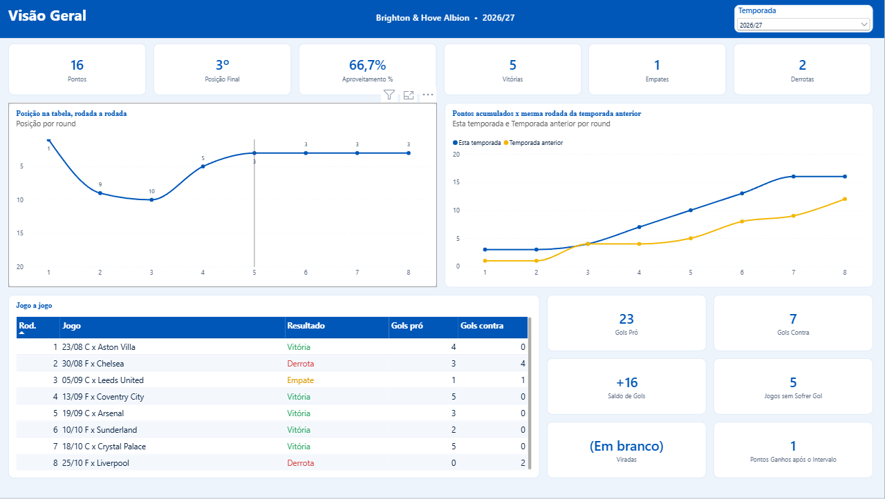
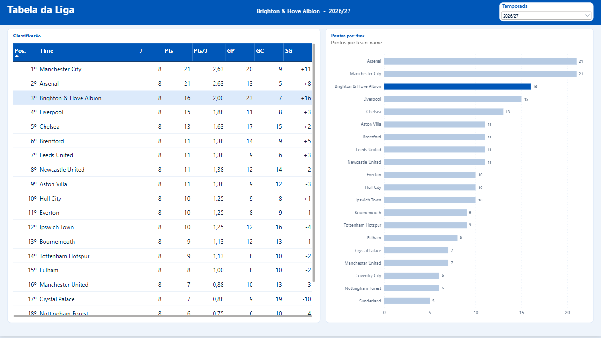
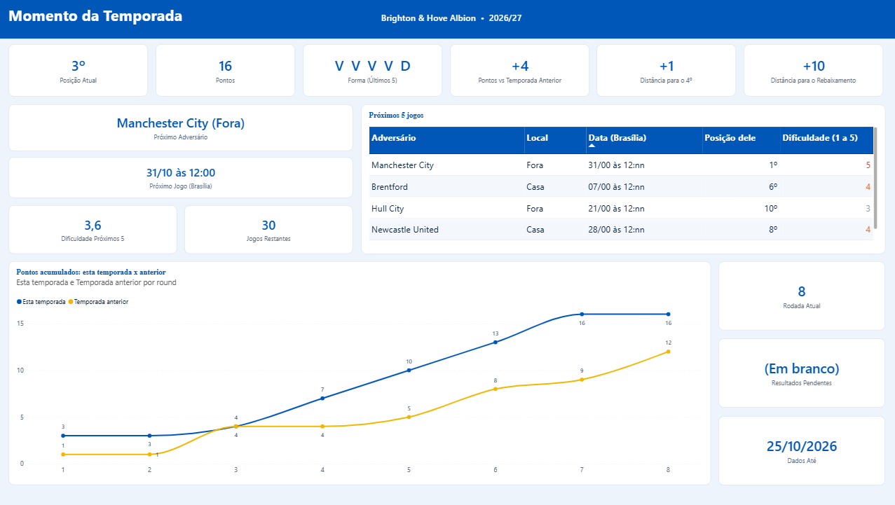
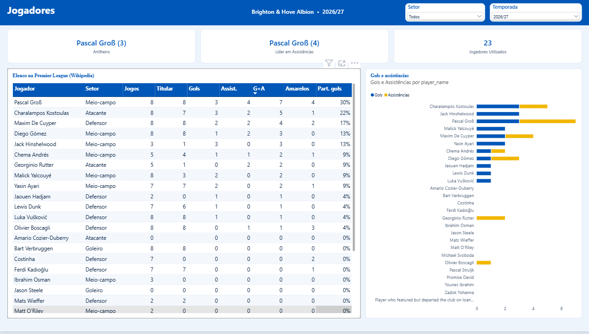
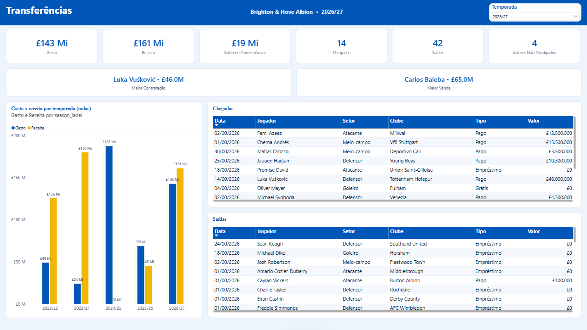
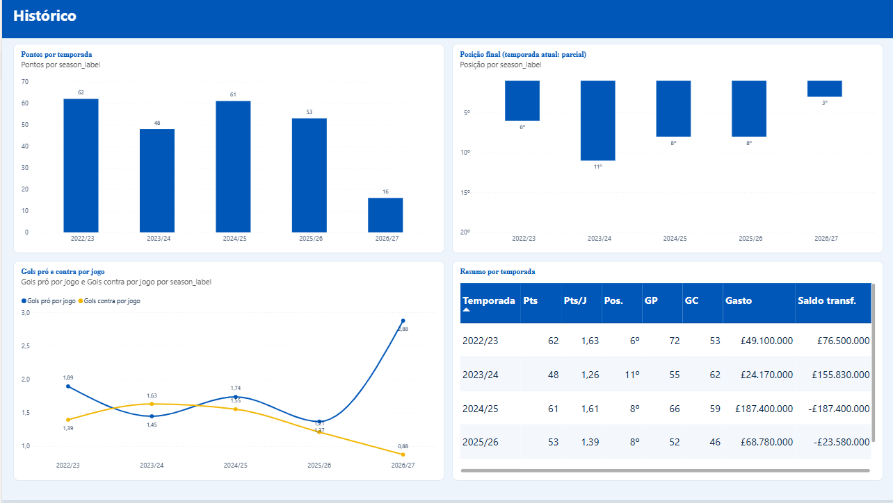
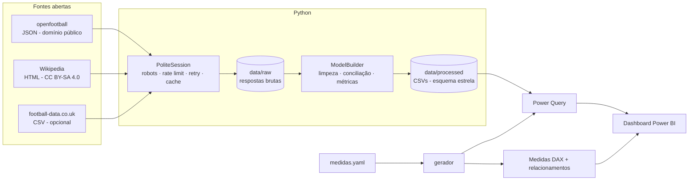
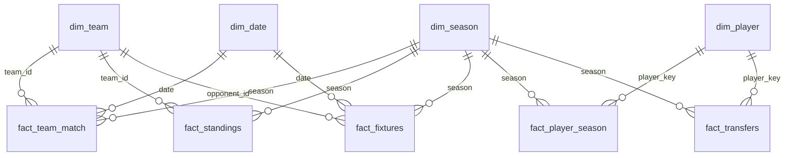

# ⚪🔵 Brighton & Hove Albion — Dashboard de Desempenho

Pipeline de dados em Python que **coleta, trata e modela** dados do Brighton na Premier League
a partir de **fontes abertas e de uso permitido**, alimentando um dashboard em **Power BI** com
6 páginas: visão geral, tabela da liga, momento da temporada, jogadores, transferências e
histórico. O projeto do Power BI (modelo e páginas) também é **gerado por código**.

> Temporada em destaque: **2026/27**, com comparação às quatro temporadas anteriores.
> Projeto pessoal de portfólio, sem fins comerciais e sem afiliação com o clube ou a Premier League.

| Visão Geral | Tabela da Liga | Momento da Temporada |
|---|---|---|
|  |  |  |
| **Jogadores** | **Transferências** | **Histórico** |
|  |  |  |

---

## O que este projeto demonstra

| Competência | Onde |
|---|---|
| Web scraping de **HTML** com BeautifulSoup, robusto a mudanças de layout | `scrapers/wikitable.py`, `scrapers/wikipedia.py` |
| Consumo de **dados abertos em JSON/CSV** | `scrapers/openfootball.py`, `scrapers/footballdata.py` |
| **Coleta responsável**: robots.txt, User-Agent identificado, rate limit, retry com backoff, cache | `http.py` |
| **Análise de legalidade das fontes** antes de coletar | seção [Fontes e licenças](#fontes-e-licenças) |
| Integração de fontes: nomes de clubes padronizados e placares conciliados | `transform/teams.py`, `transform/model.py` |
| Modelagem dimensional (**esquema estrela**) | `transform/model.py` |
| Reconstrução da tabela rodada a rodada com critérios de desempate | `transform/standings.py` |
| Testes automatizados com **dados reais**, sem internet | `tests/` (73 testes) |
| **Modelo do Power BI como código**: tabelas, tipos, relacionamentos e ~90 medidas DAX em TMDL, gerados a partir de YAML | `pbip.py`, `tmdl.py`, `powerbi/medidas.yaml` |
| **Relatório do Power BI como código**: páginas e visuais em PBIR, validados contra os esquemas oficiais da Microsoft | `report.py`, `dashboard.py` |
| "Próximo jogo" calculado pela hora atual (Python e DAX com `NOW()`), sem depender de reprocessar | `transform/model.py`, medidas da pasta 4 |

## Arquitetura



**Decisão de projeto:** coleta e transformação são etapas separadas. Os scrapers só gravam o
dado bruto em `data/raw/`; a transformação lê do disco e nunca acessa a rede. Isso permite
reprocessar à vontade, testar sem internet e não sobrecarregar os sites.

## Fontes e licenças

Antes de escrever qualquer scraper, verifiquei o `robots.txt` e os termos de uso de cada fonte.
Três fontes populares em projetos de futebol foram **descartadas**:

| Fonte descartada | Motivo |
|---|---|
| Transfermarkt | Os termos de uso proíbem acessar ou copiar o conteúdo com bots, scraping ou processos automatizados, e reservam a mineração de dados (§44b da lei alemã de direitos autorais). |
| Understat | O `robots.txt` bloqueia todos os robôs no site inteiro. |
| Fantasy Premier League / premierleague.com | Os termos permitem apenas uso privado e proíbem montar um banco de dados com o material ou redistribuí-lo sem autorização. |
| FBref | Desde janeiro de 2026 não exibe mais dados avançados (a Opta encerrou o contrato). |

Fontes usadas:

| Fonte | Licença | Técnica | O que fornece |
|---|---|---|---|
| [openfootball/football.json](https://github.com/openfootball/football.json) | Domínio público | JSON via GitHub | Resultados (com intervalo) e calendário de todos os jogos da Premier League |
| [Wikipedia](https://en.wikipedia.org) | [CC BY-SA 4.0](https://creativecommons.org/licenses/by-sa/4.0/) | HTML + BeautifulSoup | Transferências com valores, jogos/gols/assistências/cartões por jogador, placares recentes |
| [football-data.co.uk](https://www.football-data.co.uk) *(opcional, desligado)* | Ver termos do site | CSV | Chutes, chutes no gol, escanteios, faltas, cartões e árbitro por jogo |

Detalhes que mostram o cuidado com a coleta:
- O `robots.txt` da Wikipedia bloqueia `/w/` (onde fica a API) para robôs genéricos e libera
  `/wiki/`. Por isso o scraper lê a **página do artigo**, que vem do cache da Wikimedia.
- O User-Agent identifica o projeto com um contato, como pede a política da Wikimedia.
- O openfootball é mantido por voluntários e pode atrasar algumas rodadas na temporada atual;
  os placares que faltam são completados pela matriz de resultados da Wikipedia, e o modelo
  registra a origem de cada placar (`score_source`).
- **Atribuição:** os dados processados levam a licença CC BY-SA 4.0 (ver
  `data/processed/LICENSE-DATA.md`) e o dashboard mostra a fonte no rodapé.
- **LGPD / minimização:** o projeto guarda só o necessário sobre os jogadores (nome, posição,
  nacionalidade e números de jogo), sem data de nascimento, fotos ou dados pessoais extras.

## Como rodar

```bash
git clone <seu-repo> && cd brighton-dashboard
python -m venv .venv && .venv\Scripts\activate        # Linux/Mac: source .venv/bin/activate
pip install -e ".[dev]"
```

1. Abra `config.yaml` e troque `SEU_EMAIL_AQUI` em `http.user_agent` pelo seu e-mail ou pela
   URL do repositório (política de User-Agent da Wikimedia).
2. Rode o pipeline completo (~1 minuto; a maior parte é a pausa educada entre requisições):

```bash
python -m brighton all
```

Outros comandos:

```bash
python -m brighton scrape --only wikipedia   # coleta só uma fonte
python -m brighton transform                 # reprocessa a partir de data/raw (offline)
python -m brighton all --refresh             # ignora o cache local
python -m brighton powerbi                   # regenera power_query.pq, DAX e script C#
python -m brighton pbip                      # gera/sincroniza o projeto powerbi/Brighton.pbip
pytest                                       # roda os testes (sem internet)
```

Para ligar as estatísticas de chutes, leia os termos do football-data.co.uk e, se estiver de
acordo, mude `sources.football_data` para `true` no `config.yaml`.

3. Gere o projeto do Power BI e abra no **Power BI Desktop** (com o Desktop fechado ao rodar):

```bash
python -m brighton pbip
```

Abra `powerbi/Brighton.pbip` e clique em **Atualizar**. O parâmetro `PastaDados` aponta para
`data/processed`; se mover a pasta, rode de novo ou use `--pasta "C:\outro\caminho"`.
Rodar o comando outra vez **sincroniza** o modelo (colunas e medidas novas entram, o que foi
criado à mão no Power BI fica) e regrava as páginas geradas.

O [guia do dashboard](powerbi/GUIA_DASHBOARD.md) explica as medidas e como montar visuais à mão.

## Modelo de dados



| Tabela | Grão |
|---|---|
| `fact_team_match` | 1 linha por time por jogo (os 20 times), com placar final, intervalo e origem do placar |
| `fact_standings` | classificação de cada time após cada rodada (pontos, saldo, posição) |
| `fact_fixtures` | calendário do Brighton na temporada atual, com horário de Brasília e dificuldade própria |
| `fact_player_season` | jogador × temporada: jogos, titularidades, gols, assistências e cartões na Premier League |
| `fact_transfers` | chegadas e saídas por janela, com tipo (pago, empréstimo, grátis, não divulgado) |

**Validação com a realidade:** a tabela reconstruída a partir dos 380 jogos de cada temporada
bate com as classificações oficiais do Brighton: 6º em 2022/23, 11º em 2023/24, 8º em 2024/25
e 8º em 2025/26.

**Chave dos jogadores:** o link do artigo da Wikipedia (`wiki:Kaoru_Mitoma`) identifica o
mesmo jogador em todas as temporadas e tabelas. Jogadores sem artigo usam o nome normalizado.

**Parser de tabelas da Wikipedia:** as páginas de temporada mudam de um ano para outro
("Pos" / "Position", "To" / "Transferred to", cabeçalhos em duas linhas, células mescladas,
linhas de agrupamento). O `wikitable.py` expande `rowspan`/`colspan` numa grade, junta os
cabeçalhos ("Premier League|Apps") e localiza colunas por sinônimos; os testes usam trechos
reais de 2022/23 e 2026/27.

## Limitações conhecidas

- Não há métricas de xG nem mapa de chutes: as fontes que tinham esses dados não permitem
  coleta automatizada.
- O placar do intervalo só existe nos jogos vindos do openfootball.
- Valores de transferência em libras, como publicados na Wikipedia; negócios não divulgados
  ficam fora das somas.
- A qualidade dos dados de jogadores depende das páginas da Wikipedia estarem atualizadas.

## Estrutura

```
brighton-dashboard/
├── config.yaml                  # temporadas, time, fontes, ritmo da coleta
├── src/brighton/
│   ├── http.py                  # sessão com robots.txt, rate limit, retry e cache
│   ├── scrapers/                # openfootball.py · wikipedia.py · wikitable.py · footballdata.py
│   ├── transform/               # model.py · standings.py · teams.py · utils.py
│   ├── powerbi.py               # gera M, DAX e script C# a partir do medidas.yaml
│   ├── tmdl.py                  # lê e atualiza o modelo do Power BI em TMDL
│   ├── pbip.py                  # gera o projeto .pbip completo (modelo + relatório)
│   ├── report.py                # biblioteca de visuais PBIR (cartões, gráficos, tabelas, filtros)
│   ├── dashboard.py             # as 6 páginas do dashboard
│   └── pipeline.py              # CLI: scrape | transform | all | powerbi | pbip
├── powerbi/
│   ├── Brighton.pbip            # abre no Power BI Desktop (gerado por `python -m brighton pbip`)
│   ├── Brighton.SemanticModel/  # modelo em TMDL
│   ├── Brighton.Report/         # páginas em PBIR
│   ├── medidas.yaml             # ~90 medidas DAX + relacionamentos (fonte da verdade)
│   ├── power_query.pq           # consultas M geradas
│   ├── medidas_dax_query_view.dax
│   ├── criar_modelo_tabular_editor.csx
│   ├── tema_brighton_claro.json # tema nas cores do clube (azul, branco e amarelo)
│   ├── base/                    # tema base do Power BI usado pelo projeto
│   └── GUIA_DASHBOARD.md        # layout e passo a passo de cada página
├── data/{raw,cache,processed}/
├── docs/img/                    # prints do dashboard
└── tests/                       # 73 testes; fixtures reais (ver tests/fixtures/NOTICE.md)
```

## Licença

- **Código:** MIT (ver `LICENSE`).
- **Dados processados:** CC BY-SA 4.0, por conterem material da Wikipedia (ver
  `data/processed/LICENSE-DATA.md`).

## Próximos passos

- [ ] Agendar a atualização semanal (GitHub Actions ou Agendador de Tarefas do Windows)
- [ ] Comparar o Brighton com a média da liga e com clubes de orçamento parecido
- [ ] Incluir a Conference League 2026/27 (também presente nas páginas da Wikipedia)
